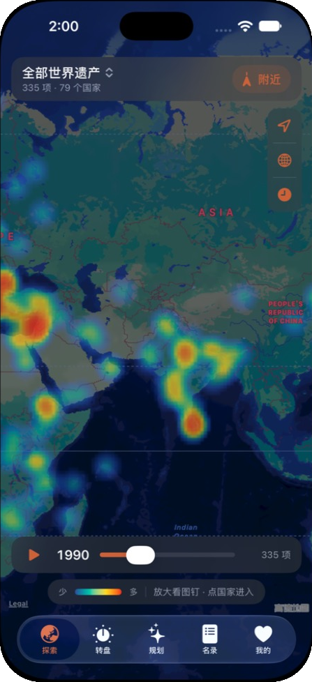
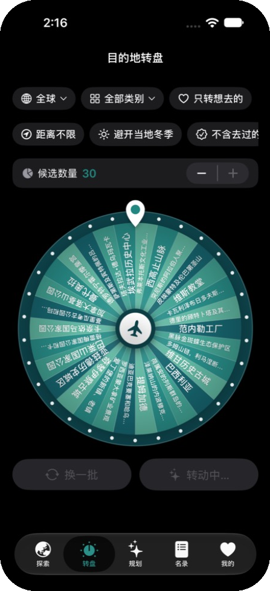
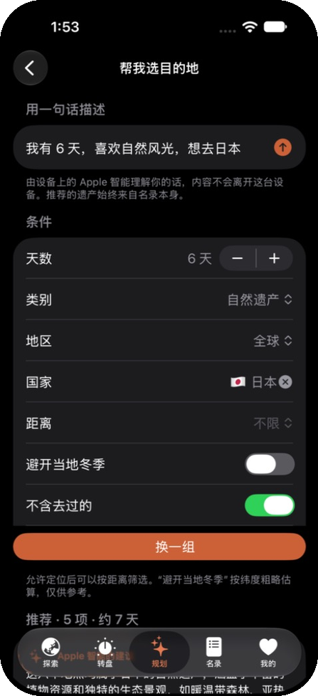
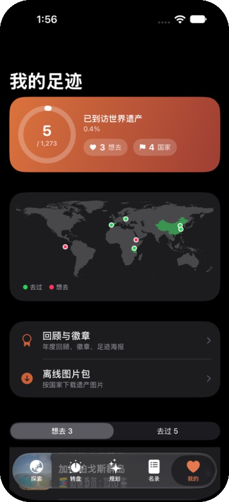
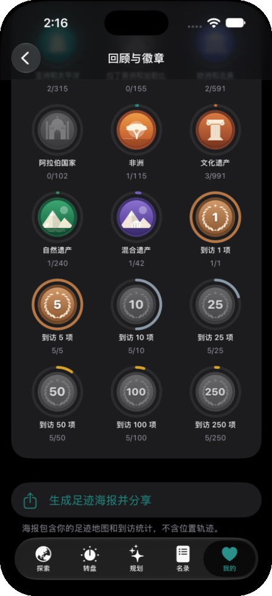
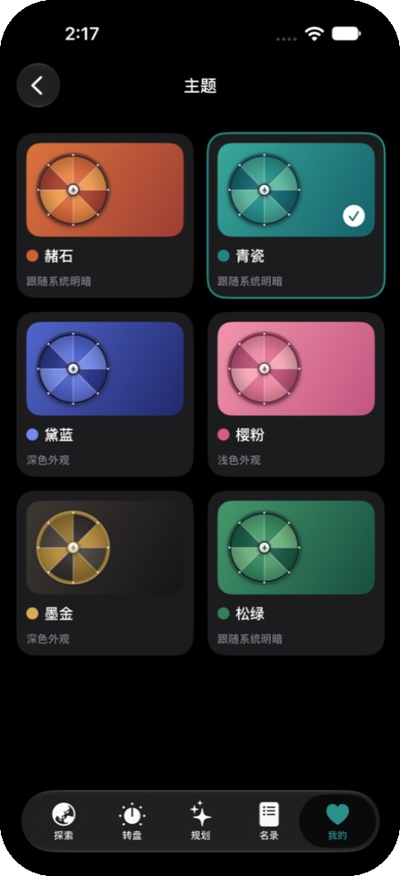
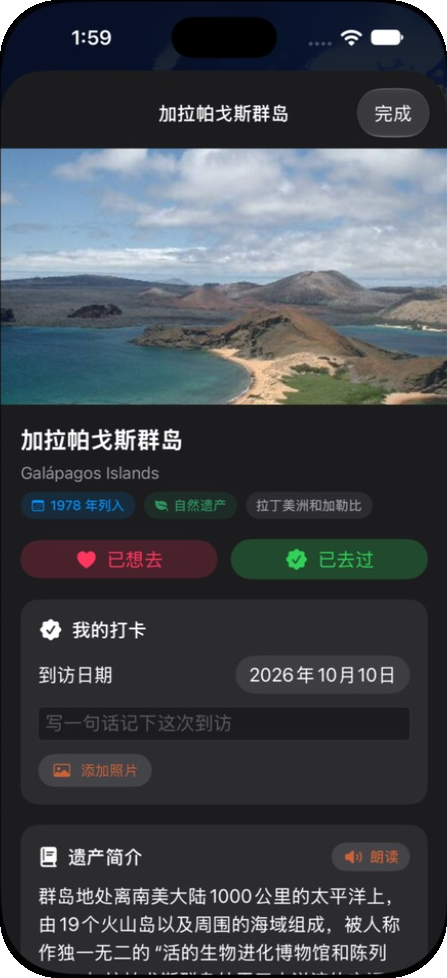

<p align="center"></p>
<h1 align="center">世遗漫游</h1>
<p align="center">**简体中文** · [English](README.en.md) · [日本語](README.ja.md) · [한국어](README.ko.md)</p>
<p align="center">基于 UNESCO 世界遗产名录的旅行目的地 App：世界热力图、国家地图、目的地转盘、设备端 AI 推荐与行程规划。</p>
<p align="center">


</p>

<table>
<tr><td align="center"><br><sub>世界热力图与时间轴</sub></td><td align="center"><br><sub>目的地转盘</sub></td><td align="center"><br><sub>AI 帮我选目的地</sub></td><td align="center"><br><sub>我的足迹</sub></td></tr>
<tr><td align="center"><br><sub>徽章</sub></td><td align="center"><br><sub>配色主题</sub></td><td align="center"><br><sub>遗产详情与打卡</sub></td></tr>
</table>

## 简介

世遗漫游把联合国教科文组织《世界遗产名录》里的 1273 项遗产放到一张可缩放的世界地图上。先看全球热力分布，再点进任意国家看具体遗产，每一项都有列入年份、入选标准和历史人文简介。不知道去哪儿时，可以交给转盘，或者用一句话告诉 App 你的想法。

全部用 SwiftUI 与 MapKit 写成，不依赖任何第三方库，也没有自建服务器：名录数据随 App 打包，AI 推荐运行在设备上。

## 功能

### 免费

- **世界热力图**：自绘的核密度热力图层，放大后切换为可聚合的遗产图钉；可按全部、文化、自然、混合、濒危切换。
- **国家地图**：点击任意国家进入，查看该国范围内的遗产分布和卡片列表。
- **遗产详情**：列入年份、类别、入选标准、简介、位置小地图，可跳转系统地图和 UNESCO 官方页面。
- **目的地转盘**：按地区、类别或“想去”清单随机抽取，候选数量 5–30 可调。
- **名录**：全部 1273 项，支持搜索、筛选和排序。
- **附近的遗产**：按与你的直线距离排序。
- **想去 / 去过**：收藏与打卡，每次打卡可记日期、一句话和一张照片。
- **目的地推荐**：按天数、类别、地区、距离给出一组地理上顺路的遗产。
- **五种语言**：简体中文、繁體中文、English、日本語、한국어，遗产名称与简介全部本地化，默认跟随系统，也可单独设置。
- **今日遗产**：每日推荐通知与主屏幕小组件。

### 订阅（Pro）

- **AI 旅行助手**：用一句话描述行程，由设备端 Apple 智能（Foundation Models）解析成条件并撰写推荐语。模型只负责理解和表达，推荐的遗产始终由 App 从名录中筛选，不会凭空编造。
- **行程规划**：把多项遗产串成路线，自动按顺路排序，估算天数与距离，导出日历文件，或在系统地图中打开。
- **条件转盘**：按距离、季节、是否去过筛选，并可保存多个转盘。
- **到达提醒与自动打卡**：走到遗产附近时通知，并自动记为去过。
- **自定义图层与时间轴**：只看想去的或没去过的；播放名录自 1978 年以来的逐年变化；卫星底图。
- **回顾与徽章**：年度回顾、地区/类别/里程碑徽章、可分享的足迹海报。
- **语音讲解**、**离线图片包**、**配色主题**（青瓷、黛蓝、樱粉、墨金、松绿）、**足迹进度小组件**、**无限收藏与 iCloud 同步**。

## 徽章设计

<p align="center"></p>

徽章与应用图标均为矢量原稿，位于 [`docs/design`](docs/design)。

## 技术要点

| 模块 | 实现 |
|---|---|
| 界面 | SwiftUI，最低支持 iOS 16 |
| 地图 | MapKit（`MKMapView` 封装），自定义 `MKOverlayRenderer` 逐瓦片绘制高斯核密度热力图 |
| 国家识别 | 内置 Natural Earth 1:50m 国界多边形，点击后做点在多边形内判断 |
| AI | Foundation Models 框架（iOS 26+），结构化输出解析意图；不可用时自动退回条件筛选 |
| 订阅 | StoreKit 2，附带本地测试用的 StoreKit 配置文件 |
| 小组件 | WidgetKit，通过 App Group 与主 App 共享少量状态 |
| 本地化 | 自建轻量字符串表，运行时切换语言无需重启 |
| 数据 | 名录数据打包在 App 内，离线可用 |

## 构建与运行

1. 需要 Xcode 26 或更新版本（工程在 Xcode 27 上开发）。
2. 用 Xcode 打开 `WorldHeritage.xcodeproj`，选择一台 iOS 16 及以上的模拟器，点击运行。
3. 调试版在“我的 → 订阅”里有一个“调试：模拟已订阅”开关，可直接体验全部订阅功能。
4. AI 助手需要 iOS 26 及以上系统，且设备支持并开启了 Apple 智能。
5. 真机运行需要在 Signing & Capabilities 中选择你自己的开发团队，并把 Bundle ID 与 App Group 改成你自己的。

## 目录结构

```
WorldHeritage/            主 App
  Models/                 数据模型、本地化、收藏、定位、主题等
  Map/                    热力图图层与地图封装
  Views/                  探索、转盘、名录、我的等页面
  Features/               AI 助手、行程规划、回顾与徽章
  Pro/                    订阅与付费墙
  Resources/              名录与国界数据
HeritageWidget/           主屏幕小组件
docs/                     截图与设计原稿
```

## 数据来源

- 名录、列入年份、入选标准与简介来自 [UNESCO World Heritage Centre](https://whc.unesco.org) 的公开数据。官方暂无中文的条目，以及全部日文、韩文内容为编译译文，可能存在疏漏，欢迎指正。
- 国界数据来自 [Natural Earth](https://www.naturalearthdata.com)。国界仅用于点击识别，不代表任何立场。
- 本项目与联合国教科文组织没有任何隶属或合作关系。

## 许可

源代码以 [PolyForm Noncommercial License 1.0.0](LICENSE.md) 发布：欢迎学习、修改和用于个人及其他非商业用途，**不允许商业使用**。作者保留商业使用的权利，包括在 App Store 上架。随 App 打包的第三方数据不在该许可范围内，详见 [NOTICE](NOTICE)。

## Star 趋势

[](https://star-history.com/#DecHHts/WorldHeritage&Date)
